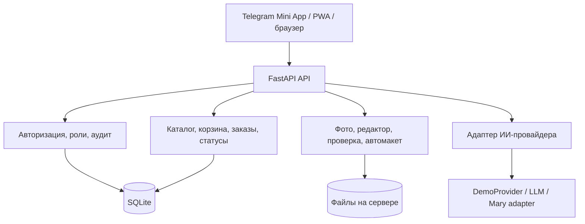

# PicPac «Момент»

Мобильный прототип заказа фотопродукции для трека 2 хакатона «Фотопринт».

**Путь пользователя:** фотографии → автоматический макет → редактирование → предпечатная проверка → тестовый заказ → отслеживание статуса.

Приложение работает в обычном мобильном браузере, как Telegram Mini App и как устанавливаемая PWA. Один интерфейс адаптирован под телефон и демонстрацию на компьютере.

> Это хакатонный прототип. Каталог, цены, пункты выдачи и заказы используют демонстрационные данные. Оплата не списывается, заказ не передаётся в реальное производство.

## Что можно показать на демо

1. Войти как клиент или начать без регистрации.
2. Выбрать фотокнигу, календарь либо печать фотографий.
3. Выбрать готовый шаблон по событию.
4. Загрузить фотографии и собрать автоматический макет.
5. Изменить порядок и кадрирование, применить фильтры или текстовую команду.
6. Проверить разрешение, резкость, освещение, риск обрезки и похожие фотографии.
7. Оформить тестовый заказ и выбрать способ получения.
8. Войти как оператор, открыть панель заказов и изменить статус.
9. Вернуться к клиенту и увидеть обновлённую статусную ленту.

Для проверки повторного оформления предусмотрена идемпотентность: повтор запроса после имитации обрыва связи не создаёт второй заказ.

## Роли

| Роль | Возможности |
|---|---|
| Гость | Изолированный черновик без регистрации; при создании аккаунта проекты и тестовые заказы переносятся |
| Клиент | Каталог, загрузка фото, редактор, автомакет, проверка качества, корзина, доставка, история и статусы |
| Оператор | Панель заказов, смена статусов, обращения, журнал действий и воронка |

Права оператора проверяются сервером, а не только интерфейсом.

## Основные возможности

- каталог фотокниг, календарей и печати фото;
- готовые шаблоны по событиям через отдельный API-слой;
- пустая корзина до реального действия пользователя;
- серверное хранение и восстановление черновиков;
- автоматическая раскладка фотографий по страницам;
- неразрушающий редактор: оригинал сохраняется отдельно, правки хранятся как параметры;
- перемещение изображения непосредственно на холсте;
- точные ползунки, отмена шага и полный сброс правок;
- проверка разрешения, резкости, яркости, пропорций и дубликатов;
- обратимая очистка подборки и Smart Story;
- тестовое оформление заказа с промокодами и защитой от дублирования;
- карта пунктов выдачи на Leaflet/OpenStreetMap;
- клиентская статусная лента и операторская панель;
- журнал действий и удаление пользовательских данных;
- Telegram Mini App, мобильный веб и PWA на одном коде;
- светлая и тёмная темы, safe-area для iPhone.

Подробная матрица функций находится в [AUDIT.md](AUDIT.md).

## ИИ и автоматизация — что работает на самом деле

| Возможность | Реализация | Статус |
|---|---|---|
| Проверка качества и поиск дубликатов | Локальные детерминированные алгоритмы Pillow и perceptual hash | Работает без внешнего ИИ |
| Автоматический макет | Серверный алгоритм с учётом даты, ориентации и числа фотографий | Работает |
| Правка фото словами | LLM разбирает только текст команды, после чего применяются существующие инструменты редактора | Демо; без сети есть правила |
| Улучшение разрешения | Локальная ONNX-модель при установленных необязательных зависимостях | Опционально |
| Удаление фона | Локальная модель при установленных необязательных зависимостях | Опционально |
| Генерация кадра по описанию | Локальная LCM-модель; возможен отдельно включаемый внешний резервный режим | Опционально |
| Помощник Робо | Локальный DemoProvider или OpenAI-совместимый LLM, например Groq/Ollama | Демо |
| Mary AI | Подготовлен адаптер провайдера | Не подключена: нужны официальная документация и ключ |

Фотографии не отправляются в языковую модель помощника. При использовании Groq/Ollama для помощника или текстовой команды передаётся только обезличенный текстовый контекст. Реальную интеграцию Mary нельзя считать готовой до получения подтверждённого API.

## Архитектура



### Технологии

- Backend: Python, FastAPI, SQLite в режиме WAL.
- Работа с изображениями: Pillow, pillow-heif; необязательные ONNX/PyTorch-модели.
- Frontend: HTML, CSS и JavaScript без этапа сборки.
- Карта: Leaflet и OpenStreetMap.
- Telegram: серверная проверка подписи `initData`.
- PWA: manifest, service worker, standalone-режим и иконки.
- Нативная оболочка: подготовленный проект Capacitor; сборка на устройствах ещё не проверена.

Swagger после запуска доступен по адресу [http://localhost:8000/docs](http://localhost:8000/docs).

## Структура репозитория

```text
app/
  backend/       FastAPI, БД, каталог, фото, заказы и ИИ-провайдеры
  frontend/      интерфейс, темы, PWA, иконки и маскоты
  tests/         интеграционные сценарии API
  scripts/       аудит стенда, сброс демо и загрузка локальных моделей
docs/            архитектура, решения, риски и результаты аудита
mobile/          оболочка Capacitor для iOS/Android
deploy/          материалы контейнеризации и развёртывания
tools/           служебные инструменты команды
AUDIT.md         состояние требований и ограничений
PRESENTATION_CONTENT.md
```

## Быстрый запуск

Требуется Python 3.11+.

### Linux / macOS

```bash
cd app
python3 -m venv .venv
.venv/bin/pip install -r requirements.txt
cp .env.example .env
.venv/bin/python -m uvicorn backend.main:app --port 8000
```

### Windows PowerShell

```powershell
cd app
py -m venv .venv
.\.venv\Scripts\python.exe -m pip install -r requirements.txt
Copy-Item .env.example .env
.\.venv\Scripts\python.exe -m uvicorn backend.main:app --port 8000
```

Откройте [http://localhost:8000](http://localhost:8000) и включите мобильный режим браузера.

Локально при `SEED_TEST_USERS=1` создаются только тестовые аккаунты:

| Роль | Логин | Пароль |
|---|---|---|
| Клиент | `demo` | `demo123` |
| Оператор | `operator` | `operator123` |

> Эти пароли предназначены только для локального запуска. На публичном стенде используются отдельные данные, которые передаются жюри напрямую.

Полная инструкция по Telegram, моделям и расширенному демо: [app/README.md](app/README.md).

## Проверки

В репозитории находится 31 интеграционный тестовый сценарий. Часть тестов необязательных нейросетевых функций может быть пропущена, если модели и тяжёлые зависимости не установлены.

```bash
cd app
.venv/bin/python -m pytest -q
.venv/bin/python scripts/audit_live.py http://localhost:8000
```

Также проверяются синтаксис Python/JavaScript, мобильные ширины 360–375 px, разграничение ролей, отсутствие секретов и повтор заказа после обрыва соединения. Зафиксированные результаты: [docs/12-final-audit.md](docs/12-final-audit.md).

## Безопасность и данные

- секреты задаются только переменными окружения и не коммитятся;
- пароли хэшируются PBKDF2-SHA256 с солью;
- сессионные токены хранятся в виде SHA-256;
- Telegram `initData` проверяется на сервере;
- чужие проекты и заказы недоступны по перебору идентификаторов;
- загруженные изображения перекодируются, EXIF и геометки удаляются;
- фотографии выдаются по временным подписанным ссылкам;
- персональные фотографии и ответы ИИ не кэшируются service worker;
- пользователь может удалить свои данные через профиль.

## Ограничения прототипа

- SQLite, локальные файлы и один процесс подходят для демонстрации, но не для промышленной нагрузки.
- Каталог, шаблоны, цены, ПВЗ и статусы производства используют mock-данные.
- Оплаты и передачи заказа в производство нет.
- Реальная Mary AI не подключена.
- Некоторые локальные модели требуют отдельной загрузки и нескольких гигабайт памяти.
- PWA и жесты проверены в эмуляции, но ещё требуют полного прохода на реальных iPhone/Android.
- Публичный стенд зависит от работающего демонстрационного компьютера; для выступления нужна резервная запись экрана.

## Что требуется для пилота

1. API или официальная выгрузка каталога, шаблонов, цен и сроков picPac.
2. Тестовый контур оформления и обновления статусов заказов.
3. Реальные пункты выдачи и правила доставки.
4. Документация Mary AI: endpoint, авторизация, формат tool calling, webhooks, лимиты и правила обработки данных.
5. PostgreSQL, объектное хранилище, очередь фоновых задач и постоянный HTTPS-сервер.
6. Тестирование на реальных мобильных устройствах и согласование интерфейса с брендбуком.

## Документация

- [AUDIT.md](AUDIT.md) — состояние функций и замечаний.
- [PRESENTATION_CONTENT.md](PRESENTATION_CONTENT.md) — содержание презентации.
- [docs/04-architecture.md](docs/04-architecture.md) — архитектурные решения.
- [docs/09-licenses.md](docs/09-licenses.md) — лицензии зависимостей.
- [docs/12-final-audit.md](docs/12-final-audit.md) — последний технический аудит.
- [app/README.md](app/README.md) — подробная инструкция запуска и демонстрации.
